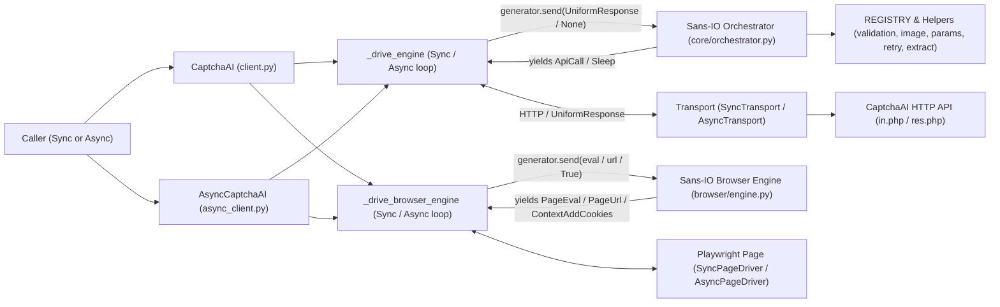
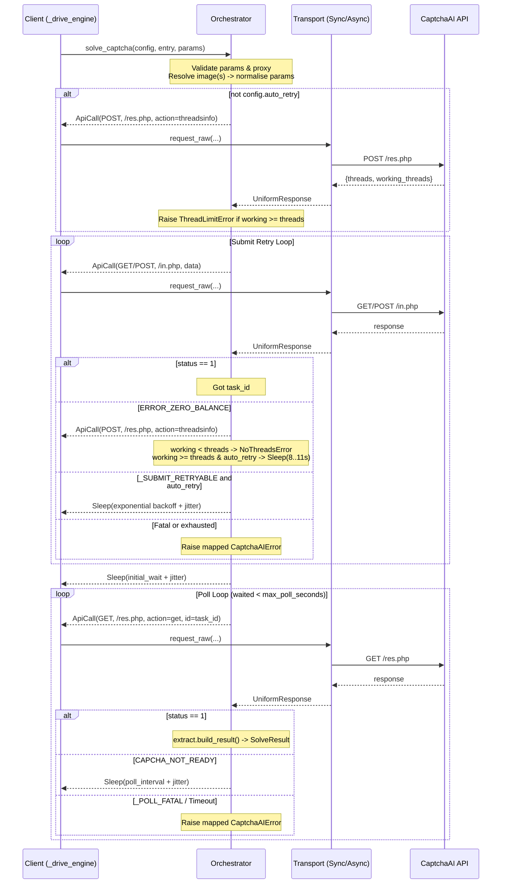

# CaptchaAI Python SDK — Architecture & Implementation

**Package:** `captchaai` (`v2.0.0`, Python `>=3.10`, typed via `py.typed`)  
**Runtime Dependency:** `httpx` (optional `playwright>=1.40` via `captchaai[playwright]`)  
**Default Endpoint:** `https://ocr.captchaai.com` (`in.php` for task submission, `res.php` for polling, balance, and thread diagnostics)

This document explains the current implementation and internal architecture of the `captchaai-python` SDK.

---

## 1. Architectural Overview & Design Philosophy

The SDK is built around a **sans-IO generator engine** pattern that separates protocol logic from network I/O and sleeping:

1. **Client Layer** ([`client.py`](file:///home/abdo/Code/Python/ABM/CAI-MCP/captchaai-python/captchaai/client.py), [`async_client.py`](file:///home/abdo/Code/Python/ABM/CAI-MCP/captchaai-python/captchaai/async_client.py)) provides the user-facing sync (`CaptchaAI`) and async (`AsyncCaptchaAI`) APIs, manages per-instance configuration and local concurrency caps, and runs a tiny driver loop (`_drive_engine`).
2. **Core Engine** ([`orchestrator.py`](file:///home/abdo/Code/Python/ABM/CAI-MCP/captchaai-python/captchaai/core/orchestrator.py)) implements all API workflows as Python generators that **never perform I/O or sleep directly**. Instead, they yield effect objects (`ApiCall` or `Sleep`) and receive `UniformResponse` (or `None`) back via `.send(...)`.
3. **Registry & Models** ([`registry.py`](file:///home/abdo/Code/Python/ABM/CAI-MCP/captchaai-python/captchaai/core/registry.py), [`config.py`](file:///home/abdo/Code/Python/ABM/CAI-MCP/captchaai-python/captchaai/core/config.py), [`result.py`](file:///home/abdo/Code/Python/ABM/CAI-MCP/captchaai-python/captchaai/core/result.py)) define declarative metadata for all 14 supported captcha types, configuration defaults, and the `SolveResult` container.
4. **Helpers** ([`captchaai/helpers/`](file:///home/abdo/Code/Python/ABM/CAI-MCP/captchaai-python/captchaai/helpers/__init__.py)) handle parameter validation, image encoding/sizing, key normalization, jittered backoff generators, and structured result extraction.
5. **Transport Layer** ([`captchaai/transport/`](file:///home/abdo/Code/Python/ABM/CAI-MCP/captchaai-python/captchaai/transport/__init__.py)) wraps `httpx.Client` and `httpx.AsyncClient`, normalizing all HTTP responses and transport exceptions into `UniformResponse` values so the orchestrator owns all retry and error-mapping decisions.
6. **Browser Layer (Optional)** ([`captchaai/browser/`](file:///home/abdo/Code/Python/ABM/captchaai-python/captchaai/browser/__init__.py)) implements a parallel sans-IO generator engine (`BrowserEffect`: `PageEval`, `PageUrl`, `ContextAddCookies`) shared by `CaptchaAI` and `AsyncCaptchaAI` via `_drive_browser_engine` for `detect_captchas`, `get_captchas_params`, `inject_on_page`, and `solve_url`, with lazy `playwright` imports.

### High-Level Component Diagram



### Repository Structure

```text
captchaai-python/
├── captchaai/
│   ├── __init__.py              # Public exports (__all__)
│   ├── client.py                # Synchronous CaptchaAI client
│   ├── async_client.py          # Asynchronous AsyncCaptchaAI client
│   ├── exceptions.py            # CaptchaAIError hierarchy (9 subclasses)
│   ├── py.typed                 # PEP 561 marker
│   ├── core/
│   │   ├── __init__.py          # Exports Config, SolveResult
│   │   ├── config.py            # Config dataclass
│   │   ├── orchestrator.py      # Sans-IO generator workflows & error maps
│   │   ├── registry.py          # CaptchaTypeEntry & REGISTRY (14 types)
│   │   └── result.py            # SolveResult dataclass
│   ├── browser/                 # Optional Playwright integration (lazy-imported)
│   │   ├── __init__.py          # Exports CaptchaParams, PageSolveResult, RECAPTCHA_INIT_HOOK_JS, drivers
│   │   ├── adapter.py           # Sync/AsyncPageDriver, proxy converter, lazy Playwright loaders
│   │   ├── engine.py            # Sans-IO BrowserEffect generators
│   │   ├── scripts.py           # In-page JS snippets for detection/extraction/injection
│   │   └── types.py             # CaptchaParams & PageSolveResult dataclasses
│   ├── helpers/
│   │   ├── __init__.py          # Exports helper submodules
│   │   ├── extract.py           # Response -> SolveResult builder
│   │   ├── image.py             # Single/multi-image encoding & size guard
│   │   ├── params.py            # API key renaming, bool -> "1"/"0", str()
│   │   ├── retry.py             # Exponential, linear, thread-busy backoff
│   │   └── validation.py        # Proxy & required/enum parameter checks
│   └── transport/
│       ├── __init__.py          # Exports BaseTransport, UniformResponse, Sync/AsyncTransport
│       ├── base.py              # UniformResponse NamedTuple & BaseTransport ABC
│       ├── sync_http.py         # httpx.Client wrapper
│       └── async_http.py        # httpx.AsyncClient wrapper
├── tests/                       # Pytest suite (9 test modules + conftest.py)
├── pyproject.toml               # Build & metadata (setuptools, httpx)
├── pytest.ini                   # asyncio_mode = auto, testpaths = tests
├── requirements.txt             # httpx
├── requirements-dev.txt         # pytest>=7.0, pytest-asyncio>=0.21
├── readme.md                    # Primary documentation
└── examples.md                  # Extended usage examples
```

---

## 2. Public API Surface

[`captchaai/__init__.py`](file:///home/abdo/Code/Python/ABM/CAI-MCP/captchaai-python/captchaai/__init__.py) (L1–40) exports:

- **Clients:** `CaptchaAI`, `AsyncCaptchaAI`
- **Result & Metadata:** `SolveResult`, `CaptchaParams`, `PageSolveResult`, `RECAPTCHA_INIT_HOOK_JS`, `supported_types`, `SUPPORTED_PROXY_TYPES` (`("HTTP", "HTTPS")`)
- **Exceptions:** `CaptchaAIError`, `InvalidKeyError`, `ValidationError`, `ProxyError`, `ThreadLimitError`, `NoThreadsError`, `UnsolvableError`, `APIError`, `NetworkError`, `TimeoutError`

`supported_types()` ([`registry.py`](file:///home/abdo/Code/Python/ABM/CAI-MCP/captchaai-python/captchaai/core/registry.py#L265-L280)) returns a fresh dictionary keyed by captcha type name containing `api_method`, `required_params` (as a `list` copy), `requires_proxy`, `returns_user_agent`, and `has_image`.

---

## 3. Client Layer (`CaptchaAI` & `AsyncCaptchaAI`)

### 3.1 Initialization, Lifecycle, and Differences

| Aspect | `CaptchaAI` ([`client.py`](file:///home/abdo/Code/Python/ABM/CAI-MCP/captchaai-python/captchaai/client.py#L25-L630)) | `AsyncCaptchaAI` ([`async_client.py`](file:///home/abdo/Code/Python/ABM/CAI-MCP/captchaai-python/captchaai/async_client.py#L28-L462)) |
| :--- | :--- | :--- |
| **Instantiation** | Standard `__init__(...)` | Direct `__init__` blocked via `__new__` (`TypeError`); must use `await AsyncCaptchaAI.create(...)` |
| **API Key Pre-check** | Validates `isinstance(api_key, str)` and `len(api_key.strip()) == 32` locally (`InvalidKeyError`) | Delegates key validation to the startup `threadsinfo` API call |
| **Proxy Validation** | `validate_proxy_options(proxy, proxytype)` | `validate_proxy_options(proxy, proxytype)` |
| **Retry Resolution** | If `max_retries is not None`: `auto_retry = max_retries > 0`, `effective_max_retries = max_retries`; else `auto_retry` param & `5` | Identical |
| **Startup Probe** | Calls `orchestrator.get_thread_usage(self._config)` to populate `self._thread_cap` | Awaits `orchestrator.get_thread_usage(self._config)` to populate `self._thread_cap` |
| **Concurrency Lock** | `threading.Lock()` guarding `self._inflight` | `asyncio.Lock()` guarding `self._inflight` |
| **Transport** | `SyncTransport(timeout=30.0)` | `AsyncTransport(timeout=30.0)` |
| **Cleanup** | `close()` (does **not** implement `__enter__`/`__exit__`) | `await aclose()`, plus `__aenter__` / `__aexit__` async context manager |

### 3.2 Sans-IO Driver Loop (`_drive_engine`)

Both clients execute orchestrator generators using an identical protocol ([`client.py`](file:///home/abdo/Code/Python/ABM/CAI-MCP/captchaai-python/captchaai/client.py#L104-L128), [`async_client.py`](file:///home/abdo/Code/Python/ABM/CAI-MCP/captchaai-python/captchaai/async_client.py#L124-L145)):

1. Prime the generator with `next(engine)`.
2. Loop until `StopIteration`:
   - If the yielded effect is `ApiCall(method, url, data)`: execute (or `await`) `self._transport.request_raw(method, url, data)` and feed the `UniformResponse` back via `engine.send(response)`.
   - If the yielded effect is `Sleep(seconds)`: call `time.sleep(seconds)` (or `await asyncio.sleep(seconds)`) and feed `None` via `engine.send(None)`.
   - Any unknown effect raises `APIError`.
3. If an exception is raised outside the generator (no custom handling needed here), or inside the generator, it propagates directly; on `StopIteration as stop`, return `stop.value`.

### 3.3 Solve Dispatch & Local Concurrency Gate (`_solve_type`)

All convenience solve methods delegate to `_solve_type(type_name, params, *, proxy=None, proxytype=None)` ([`client.py`](file:///home/abdo/Code/Python/ABM/CAI-MCP/captchaai-python/captchaai/client.py#L131-L175), [`async_client.py`](file:///home/abdo/Code/Python/ABM/CAI-MCP/captchaai-python/captchaai/async_client.py#L148-L189)):

1. Looks up `entry = get_entry(type_name)`.
2. **Per-call proxy override:** If `proxy is not None`, validates `proxytype` via `validate_proxy_options(proxy, proxytype)` and creates an ephemeral `cfg = dataclasses.replace(self._config, proxy=proxy, proxytype=norm_proxytype)` without mutating `self._config`.
3. **In-flight thread cap (when `not cfg.auto_retry`):** Acquires `_inflight_lock`; if `self._inflight >= self._thread_cap`, raises `ThreadLimitError` immediately before any network call. Otherwise increments `self._inflight`, runs `orchestrator.solve_captcha(cfg, entry, params)`, and decrements `self._inflight` in a `finally` block. When `cfg.auto_retry` is `True`, concurrent calls are not rejected locally.

### 3.4 Public Methods

Both `CaptchaAI` and `AsyncCaptchaAI` expose identical method signatures (with `async def` on `AsyncCaptchaAI`):

**Convenience Solvers (all return `SolveResult`):**
- `normal(image, *, numeric=None, min_len=None, max_len=None, phrase=None, case_sensitive=None, lang=None, instructions=None, proxy=None, proxytype=None)` — maps `case_sensitive` -> `"caseSensitive"`, `instructions` -> `"textinstructions"`.
- `grid(image, instructions, grid_size, *, proxy=None, proxytype=None)` — injects `img_type="recaptcha"`.
- `bls(images, instructions, *, proxy=None, proxytype=None)` — expects 9 images.
- `recaptcha_v2(sitekey, url, invisible=False, enterprise=False, action=None, *, cookies=None, user_agent=None, proxy=None, proxytype=None)` — selects `"recaptcha_v2_enterprise"` if `enterprise`, else `"recaptcha_v2_invisible"` if `invisible`, else `"recaptcha_v2"`; maps `sitekey` -> `"googlekey"`, `url` -> `"pageurl"`.
- `recaptcha_v3(sitekey, url, action=None, enterprise=False, min_score=None, *, cookies=None, user_agent=None, proxy=None, proxytype=None)` — selects `"recaptcha_v3_enterprise"` or `"recaptcha_v3"`; injects `"version": "v3"`.
- `turnstile(sitekey, url, *, cookies=None, user_agent=None, proxy=None, proxytype=None)`
- `cloudflare_challenge(url, *, cookies=None, user_agent=None, proxy=None, proxytype=None)`
- `geetest(gt, challenge, url, *, cookies=None, user_agent=None, proxy=None, proxytype=None)`
- `captchafox(sitekey, url, *, cookies=None, user_agent=None, proxy=None, proxytype=None)`
- `friendly_captcha(sitekey, url, *, version=None, proxy=None, proxytype=None)`
- `lemin(captcha_id, div_id, url, *, api_server=None, proxy=None, proxytype=None)`

**Utility & Two-Step Methods:**
- `threads_info() -> dict` — drives `orchestrator.get_thread_usage(self._config)`.
- `get_balance() -> str` — drives `orchestrator.get_balance(self._config)`.
- `send(captcha_type: str, **params) -> str` — submits a task via `orchestrator.submit_task(self._config, get_entry(captcha_type), params)` and returns `task_id`.
- `get_result(captcha_type: str, task_id: str) -> SolveResult` — polls an existing `task_id` via `orchestrator.fetch_result(self._config, get_entry(captcha_type), task_id)`.

**Browser Methods (optional `captchaai[playwright]`):**
- `detect_captchas(page) -> list[str]` — drives `browser.engine.detect_captchas()` to return deduplicated token-mode CAPTCHA types on `page`.
- `get_captchas_params(page) -> list[CaptchaParams]` — drives `browser.engine.get_captchas_params()` to extract structured parameters for detected CAPTCHAs.
- `inject_on_page(page, params, result) -> bool` — drives `browser.engine.inject_on_page()` to inject solved tokens into the DOM/callbacks or add the `cf_clearance` cookie to `page.context`.
- `solve_url(url=None, *, page=None, headless=True, wait_timeout=3000.0, close_delay=0.0, autofill=True, throw_on_error=False, default_v3_action="verify", proxy=None, proxytype=None) -> list[PageSolveResult]` — either launches Chromium (installing `RECAPTCHA_INIT_HOOK_JS` via `page.context.add_init_script(...)` and closing afterwards) or operates on a caller-supplied open `page` (leaving it open for post-solve actions).

---

## 4. Core Layer (`captchaai/core/`)

### 4.1 Configuration (`config.py`)

[`Config`](file:///home/abdo/Code/Python/ABM/CAI-MCP/captchaai-python/captchaai/core/config.py#L11-L39) is a `@dataclass` with no environment variable lookups:

| Field | Type | Default | Role |
| :--- | :--- | :--- | :--- |
| `api_key` | `str` | *(required)* | 32-char CaptchaAI API key |
| `proxy` | `str \| None` | `None` | `"user:pass@host:port"` |
| `proxytype` | `str \| None` | `None` | `"HTTP"` or `"HTTPS"` |
| `auto_retry` | `bool` | `True` | Enables/disables retries on transient, proxy, and busy-thread errors |
| `base_url` | `str` | `"https://ocr.captchaai.com"` | API base URL |
| `network_timeout` | `float` | `30.0` | Per-request `httpx` timeout (seconds) |
| `max_retries` | `int` | `5` | Cap on transient submit retry attempts |
| `max_poll_seconds` | `float` | `180.0` | Logical polling deadline before `TimeoutError` |
| `jitter_max` | `float` | `1.0` | Max uniform random jitter added to sleeps |
| `submit_backoff_base` | `float` | `5.0` | Base seconds for exponential submit backoff |
| `thread_busy_wait` | `float` | `5.0` | Legacy field (superseded by `thread_busy_timeout`) |
| `thread_busy_timeout` | `float` | `120.0` | Logical seconds budget for `ERROR_ZERO_BALANCE` busy-thread retries |

### 4.2 Captcha Type Registry (`registry.py`)

[`REGISTRY`](file:///home/abdo/Code/Python/ABM/CAI-MCP/captchaai-python/captchaai/core/registry.py#L50-L242) maps 14 type names to frozen [`CaptchaTypeEntry`](file:///home/abdo/Code/Python/ABM/CAI-MCP/captchaai-python/captchaai/core/registry.py#L14-L44) specs:

| Type Name | `api_method` | HTTP | `solution_key` | `has_image` | `is_structured` | `returns_user_agent` | `requires_proxy` | `initial_wait` / `poll_interval` | `required_params` (`valid_values`) |
| :--- | :--- | :--- | :--- | :--- | :--- | :--- | :--- | :--- | :--- |
| `normal` | `base64` | `POST` | `request` | Yes | No | No | No | `1s` / `5s` | `image` |
| `grid` | `base64` | `POST` | `request` | Yes | Yes | No | No | `1s` / `5s` | `image`, `instructions`, `grid_size` (`3x3`, `4x4`) |
| `bls` | `bls` | `POST` | `request` | Yes | Yes | No | No | `1s` / `5s` | `images`, `instructions` |
| `recaptcha_v2` | `userrecaptcha` | `GET` | `request` | No | No | No | No | `15s` / `5s` | `googlekey`, `pageurl` |
| `recaptcha_v2_invisible` | `userrecaptcha` | `GET` | `request` | No | No | No | No | `15s` / `5s` | `googlekey`, `pageurl` |
| `recaptcha_v2_enterprise` | `userrecaptcha` | `POST` | `result` | No | No | Yes | No | `15s` / `5s` | `googlekey`, `pageurl` |
| `recaptcha_v3` | `userrecaptcha` | `GET` | `request` | No | No | No | No | `10s` / `5s` | `googlekey`, `pageurl`, `action` |
| `recaptcha_v3_enterprise` | `userrecaptcha` | `POST` | `result` | No | No | Yes | No | `10s` / `5s` | `googlekey`, `pageurl`, `action` |
| `turnstile` | `turnstile` | `GET` | `request` | No | No | No | No | `10s` / `5s` | `sitekey`, `pageurl` |
| `cloudflare_challenge` | `cloudflare_challenge` | `POST` | `result` | No | No | Yes | **Yes** | `15s` / `5s` | `pageurl` |
| `geetest` | `geetest` | `GET` | `request` | No | Yes | No | No | `15s` / `5s` | `gt`, `challenge`, `pageurl` |
| `captchafox` | `captchafox` | `GET` | `request` | No | No | Yes | **Yes** | `10s` / `5s` | `sitekey`, `pageurl` |
| `friendly_captcha` | `friendly_captcha` | `GET` | `request` | No | No | No | No | `10s` / `5s` | `sitekey`, `pageurl` |
| `lemin` | `lemin` | `GET` | `request` | No | Yes | No | No | `10s` / `5s` | `captcha_id`, `div_id`, `pageurl` |

`get_entry(name)` raises `ValidationError(f"Unknown captcha type: {name!r}")` on unknown keys.

### 4.3 Result Container (`result.py`)

[`SolveResult`](file:///home/abdo/Code/Python/ABM/CAI-MCP/captchaai-python/captchaai/core/result.py#L11-L43) holds:
- `task_id: str`
- `solution: str | list | dict`
- `user_agent: str | None = None`
- `raw: dict | None = None`
- `raw_text: str | None = None`
- `__str__()`: returns `str(self.solution)` for `dict`/`list` solutions, or `self.solution` directly for strings.

### 4.4 Orchestrator Workflows (`orchestrator.py`)

[`orchestrator.py`](file:///home/abdo/Code/Python/ABM/CAI-MCP/captchaai-python/captchaai/core/orchestrator.py) defines `ApiCall(method, url, data)` and `Sleep(seconds)` (`Effect = ApiCall | Sleep`) and implements 7 generator functions:

1. **`get_thread_usage(config)`** (L187–201): `POST /res.php` with `action="threadsinfo", json=1` -> validates key -> returns `{"threads": int, "working_threads": int}`.
2. **`get_balance(config)`** (L204–220): `POST /res.php` with `action="getbalance", json=1` -> validates key -> requires `status == 1` and non-empty `request` -> returns raw `str`.
3. **`submit_task(config, entry, params)`** (L222–340):
   - Runs `validation.validate(params, entry)` and checks proxy constraints (`entry.requires_proxy` requires both `config.proxy` and `config.proxytype`; `config.proxytype` without `config.proxy` also raises `ValidationError`).
   - Resolves images (`image.resolve`) if `entry.has_image`, normalizes parameters (`params_helper.normalise`), and attaches `key`, `method`, `json=1`, plus `proxy`/`proxytype` if configured.
   - If `not config.auto_retry`: proactively queries `threadsinfo` and raises `ThreadLimitError` if `working_threads >= threads` before submitting.
   - Submits to `in.php` via `entry.submit_http_method` in a retry loop:
     - `status == 1`: returns `task_id`.
     - `_SUBMIT_FATAL`: raises immediately.
     - `ERROR_ZERO_BALANCE`: delegates to `diagnose_account_when_busy(config)`.
     - `_SUBMIT_RETRYABLE`: if `auto_retry` and `attempts <= max_retries`, yields `Sleep(next(backoff))` (exponential `submit_backoff_base * 2^step + uniform(0, jitter_max)`).
4. **`diagnose_account_when_busy(config)`** (L343–355):
   - Queries `threadsinfo`. Note that CaptchaAI returns `ERROR_ZERO_BALANCE` both when an account is out of plan/expired and when all threads are occupied:
     - If `working_threads >= threads`: returns `config.auto_retry` (`True` triggers a `thread_busy_backoff()` sleep of `8.0 + uniform(0, 3.0)`s up to `config.thread_busy_timeout`; `False` raises `ThreadLimitError`).
     - If `working_threads < threads`: raises `NoThreadsError("Account expired or has no active plan")`.
5. **`poll_until_ready(config, entry, task_id)`** (L357–408):
   - Yields initial `Sleep(add_jitter(entry.initial_wait, config.jitter_max))`.
   - Polls `GET /res.php` (`action="get", id=task_id, json=1`) using a **logical clock** (`waited += entry.poll_interval`, excluding jitter) against `config.max_poll_seconds`:
     - `status == 1`: returns response `dict`.
     - `CAPCHA_NOT_READY`: sleeps `poll_interval + jitter` until `waited >= max_poll_seconds`, then raises `TimeoutError`.
     - `_POLL_FATAL`: raises immediately.
     - `ERROR_PROXY_CONNECTION_FAILED`: retries if `auto_retry` and within `max_poll_seconds`, else raises `ProxyError`.
6. **`fetch_result(config, entry, task_id)`** (L411–420): runs `poll_until_ready` then `extract.build_result`.
7. **`solve_captcha(config, entry, params)`** (L423–435): chains `submit_task` -> `poll_until_ready` -> `extract.build_result`.

#### `solve_captcha` Lifecycle Sequence



---

## 5. Helpers Layer (`captchaai/helpers/`)

- **Parameter Validation ([`validation.py`](file:///home/abdo/Code/Python/ABM/CAI-MCP/captchaai-python/captchaai/helpers/validation.py)):**
  - `SUPPORTED_PROXY_TYPES = ("HTTP", "HTTPS")`.
  - `validate_proxy_options(proxy, proxytype)`: enforces that `proxytype` is present when `proxy` is truthy, strips/uppercases `proxytype`, and rejects unsupported protocols (e.g., `SOCKS4`, `SOCKS5`) with `ValidationError`.
  - `validate(params, entry)`: ensures every key in `entry.required_params` is non-`None` and non-blank (for strings), and checks `entry.valid_values` (e.g., `grid_size` in `("3x3", "4x4")`).
- **Image Resolution ([`image.py`](file:///home/abdo/Code/Python/ABM/CAI-MCP/captchaai-python/captchaai/helpers/image.py)):**
  - `resolve(params, entry)` mutates `params` in place:
    - For `bls` (`"images" in params`), `_resolve_many()` pops `"images"`, requires a list/tuple of length `9`, and populates `image_base64_1` through `image_base64_9` as `data:image/png;base64,...` data-URIs.
    - For `normal`/`grid`, pops `"image"` and sets `params["body"] = _to_base64(src)`.
  - `_to_base64(src)` accepts: `bytes`, `http://`/`https://` URLs (downloaded via synchronous `httpx.get(s, timeout=30.0)`), `data:` URIs, local file paths, or validated raw base64 strings (`base64.b64decode(..., validate=True)`).
  - `_check_image_dimensions()` inspects PNG (IHDR) and GIF (`GIF87a`/`GIF89a`) headers and raises `ValidationError` if width or height exceeds `_MAX_IMAGE_DIMENSION = 1000` pixels.
- **Parameter Normalization ([`params.py`](file:///home/abdo/Code/Python/ABM/CAI-MCP/captchaai-python/captchaai/helpers/params.py)):**
  - `normalise(params)` drops `None` values, renames keys (`"url"` -> `"pageurl"`, `"user_agent"` -> `"userAgent"`, `"api_server"` -> `"apiServer"`), converts `bool` values to `"1"`/`"0"`, and stringifies all remaining values.
- **Result Extraction ([`extract.py`](file:///home/abdo/Code/Python/ABM/CAI-MCP/captchaai-python/captchaai/helpers/extract.py)):**
  - `build_result(response, entry, task_id)` reads `response.get(entry.solution_key)` (`"request"` or `"result"`), preserves `raw_text` if the answer is a string, parses JSON with `json.loads()` when `entry.is_structured` is `True` (raising `APIError` on `JSONDecodeError`), attaches `user_agent` when `entry.returns_user_agent` is `True`, and returns `SolveResult`.
- **Retry Backoff Generators ([`retry.py`](file:///home/abdo/Code/Python/ABM/CAI-MCP/captchaai-python/captchaai/helpers/retry.py)):**
  - `add_jitter(seconds, jitter_max)` -> `seconds + random.uniform(0, jitter_max)`
  - `exponential(base, jitter_max, factor=2.0)` -> unbounded generator yielding `base * (factor ** step) + jitter`
  - `linear(step_seconds, jitter_max)` -> unbounded generator yielding `step_seconds + jitter`
  - `thread_busy_backoff(interval=8.0, jitter_max=3.0)` -> unbounded generator yielding `interval + jitter`

---

## 6. Transport Layer (`captchaai/transport/`)

- **[`base.py`](file:///home/abdo/Code/Python/ABM/CAI-MCP/captchaai-python/captchaai/transport/base.py):** Defines `UniformResponse(status_code, body, raw_text=None, transport_error_type=None, transport_error_message=None)` and `BaseTransport.request_raw(method, url, data)`.
- **[`sync_http.py`](file:///home/abdo/Code/Python/ABM/CAI-MCP/captchaai-python/captchaai/transport/sync_http.py) & [`async_http.py`](file:///home/abdo/Code/Python/ABM/CAI-MCP/captchaai-python/captchaai/transport/async_http.py):**
  - Wrap a single persistent `httpx.Client(timeout=timeout)` (`SyncTransport`) or `httpx.AsyncClient(timeout=timeout)` (`AsyncTransport`) using `httpx` defaults for headers, SSL, and environment proxies.
  - Route `GET` via `params=data` and other methods (`POST`) via form-encoded `data=data`.
  - Parse JSON via `response.json()`; on `ValueError` return `UniformResponse(response.status_code, None, raw_text=response.text)` (preserving plain-text API errors like `"ERROR_UPLOAD"`).
  - Catch any `Exception as exc` and return `UniformResponse(999, None, transport_error_type=type(exc).__name__, transport_error_message=str(exc) or None)` instead of raising, keeping exception classification centralized in `orchestrator.py`.

---

## 7. Exception Hierarchy & Error Mapping

All exceptions inherit from [`CaptchaAIError`](file:///home/abdo/Code/Python/ABM/CAI-MCP/captchaai-python/captchaai/exceptions.py#L8-L85):

```text
CaptchaAIError
├── InvalidKeyError    # 32-char check, ERROR_WRONG_USER_KEY, ERROR_KEY_DOES_NOT_EXIST
├── ValidationError    # Local param/image/proxy checks, _SUBMIT_FATAL param/image codes
├── ProxyError         # ERROR_BAD_PROXY, ERROR_PROXY_CONNECTION_FAILED (when exhausted/no auto_retry)
├── ThreadLimitError   # Local _inflight >= _thread_cap, proactive threadsinfo, or busy-thread timeout
├── NoThreadsError     # ERROR_ZERO_BALANCE with working_threads < threads (expired/no plan)
├── UnsolvableError    # ERROR_CAPTCHA_UNSOLVABLE
├── APIError           # IP_BANNED, ERROR_SERVER_ERROR, ERROR_INTERNAL_SERVER_ERROR, task ID errors, malformed JSON
├── NetworkError       # Transport sentinel status_code == 999 (classified into timeout/DNS/connection messages)
└── TimeoutError       # Poll deadline exceeded (CAPCHA_NOT_READY past max_poll_seconds)
```

### API Code Mapping (`orchestrator.py`)

| Phase / Condition | API Code / Signal | Mapped Exception | Retryable? |
| :--- | :--- | :--- | :--- |
| Submit (`_SUBMIT_FATAL` & plain-text `raw_text`) | `ERROR_WRONG_USER_KEY`, `ERROR_KEY_DOES_NOT_EXIST` | `InvalidKeyError` | No |
| Submit (`_SUBMIT_FATAL` & plain-text `raw_text`) | `ERROR_BAD_PARAMETERS`, `ERROR_PAGEURL`, `ERROR_GOOGLEKEY`, `ERROR_WRONG_GOOGLEKEY`, `ERROR_TOO_BIG_CAPTCHA_FILESIZE`, `ERROR_ZERO_CAPTCHA_FILESIZE`, `ERROR_IMAGE_DIMENSIONS_TOO_LARGE`, `ERROR_WRONG_FILE_EXTENSION`, `ERROR_IMAGE_TYPE_NOT_SUPPORTED`, `ERROR_UPLOAD`, `ERROR_BAD_TOKEN_OR_PAGEURL` | `ValidationError` | No |
| Submit (`_SUBMIT_FATAL`) | `ERROR_BAD_PROXY` | `ProxyError` | No |
| Submit (`_SUBMIT_FATAL`) | `IP_BANNED` | `APIError` | No |
| Submit (`_SUBMIT_RETRYABLE`) | `ERROR_SERVER_ERROR`, `ERROR_INTERNAL_SERVER_ERROR` | `APIError` | Yes (`max_retries`) |
| Submit (`_SUBMIT_RETRYABLE`) | `ERROR_PROXY_CONNECTION_FAILED` | `ProxyError` | Yes (`max_retries`) |
| Submit (`ERROR_ZERO_BALANCE`) | `working_threads >= threads` | `ThreadLimitError` | Yes (`thread_busy_timeout` if `auto_retry`) |
| Submit (`ERROR_ZERO_BALANCE`) | `working_threads < threads` | `NoThreadsError` | No |
| Poll | `CAPCHA_NOT_READY` | `TimeoutError` (at deadline) | Yes (`max_poll_seconds`) |
| Poll (`_POLL_FATAL`) | `ERROR_CAPTCHA_UNSOLVABLE` | `UnsolvableError` | No |
| Poll (`_POLL_FATAL`) | `ERROR_WRONG_USER_KEY`, `ERROR_KEY_DOES_NOT_EXIST` | `InvalidKeyError` | No |
| Poll (`_POLL_FATAL`) | `ERROR_WRONG_ID_FORMAT`, `ERROR_WRONG_CAPTCHA_ID`, `ERROR_EMPTY_ACTION` | `APIError` | No |
| Poll | `ERROR_PROXY_CONNECTION_FAILED` | `ProxyError` | Yes (`max_poll_seconds` if `auto_retry`) |
| Transport (`_NETWORK_FAIL = 999`) | Timeout / DNS / Connect exception | `NetworkError` | No |
| Response parsing | Malformed JSON, unknown code, missing `solution_key`/`threadsinfo` fields | `APIError` | No |

---

## 8. Test Suite Architecture & Coverage

[`pytest.ini`](file:///home/abdo/Code/Python/ABM/CAI-MCP/captchaai-python/pytest.ini) configures `asyncio_mode = auto`, `testpaths = tests`, and `pythonpath = .`.

### Mocking & Test Harness ([`tests/conftest.py`](file:///home/abdo/Code/Python/ABM/CAI-MCP/captchaai-python/tests/conftest.py))

- **`no_sleep` fixture:** Monkeypatches `captchaai.client.time.sleep` and `captchaai.async_client.asyncio.sleep` to no-ops so logical retry/poll deadlines run instantaneously.
- **Transport Doubles:** `MockSyncTransport` and `MockAsyncTransport` replace `SyncTransport`/`AsyncTransport` and record `(method, url, dict(data))` calls without real HTTP traffic.
- **Direct Generator Driver:** `drive_sync_engine(engine, responses)` steps `orchestrator` generators directly by feeding canned `UniformResponse` values on `ApiCall` effects and `None` on `Sleep` effects.
- **Client Builders:** `make_sync_client`, `make_async_client`, and `make_sync_bypass` (uses `object.__new__(CaptchaAI)` to inject custom `_thread_cap`/`_inflight` states for concurrency testing).
- **`REGISTRY_SOLVE_CASES`:** Parametrized matrix covering all 14 `REGISTRY` entries.

### Test Modules

| File | Primary Target | What It Verifies |
| :--- | :--- | :--- |
| [`test_registry.py`](file:///home/abdo/Code/Python/ABM/CAI-MCP/captchaai-python/tests/test_registry.py) | `core/registry.py` | All 14 registry entries, field invariants, `requires_proxy`, `grid_size` valid values, `get_entry()` errors |
| [`test_validation.py`](file:///home/abdo/Code/Python/ABM/CAI-MCP/captchaai-python/tests/test_validation.py) | `helpers/validation.py` | Required params, whitespace rejection, `grid_size` enum, `HTTP`/`HTTPS` proxy normalization & rejection of `SOCKS4`/`SOCKS5` |
| [`test_extract.py`](file:///home/abdo/Code/Python/ABM/CAI-MCP/captchaai-python/tests/test_extract.py) | `helpers/extract.py`, `SolveResult` | Token vs structured list/dict parsing, `result` vs `request` `solution_key`, `user_agent` extraction, JSON/missing-key errors |
| [`test_exceptions.py`](file:///home/abdo/Code/Python/ABM/CAI-MCP/captchaai-python/tests/test_exceptions.py) | `exceptions.py`, `orchestrator.py` | Submit fatal mappings, poll fatal mappings, `NetworkError` timeout vs connection messages |
| [`test_orchestrator.py`](file:///home/abdo/Code/Python/ABM/CAI-MCP/captchaai-python/tests/test_orchestrator.py) | `core/orchestrator.py` | URL joining, `get_thread_usage`, `submit_task` (`ERROR_ZERO_BALANCE` disambiguation, transient retries, proactive thread check), `poll_until_ready` deadlines, `solve_captcha`, plain-text `ERROR_UPLOAD` |
| [`test_client.py`](file:///home/abdo/Code/Python/ABM/CAI-MCP/captchaai-python/tests/test_client.py) | `client.py` | Key length & proxy init checks, `max_retries` mapping, `recaptcha_v2`/`v3` variants, non-mutating per-call proxy override, all 14 registry solves, `threads_info`, `send`/`get_result`, `close()` |
| [`test_async_client.py`](file:///home/abdo/Code/Python/ABM/CAI-MCP/captchaai-python/tests/test_async_client.py) | `async_client.py` | Blocked direct instantiation, `create()` proxy validation, `recaptcha_v3` `action`, all 14 registry solves, `threads_info`, `send`/`get_result`, `async with` transport cleanup |
| [`test_balance.py`](file:///home/abdo/Code/Python/ABM/CAI-MCP/captchaai-python/tests/test_balance.py) | `get_balance()`, `supported_types()` | Sync/async raw string balance return, invalid key & empty/error responses, defensive copies from `supported_types()` |
| [`test_thread_limit.py`](file:///home/abdo/Code/Python/ABM/CAI-MCP/captchaai-python/tests/test_thread_limit.py) | Concurrency & thread caps | `_inflight >= _thread_cap` gating in sync & async, `_inflight` decrement on completion, proactive `threadsinfo` check, multi-threaded sync contention (`threading.Event`) |
| [`test_browser.py`](file:///home/abdo/Code/Python/ABM/captchaai-python/tests/test_browser.py) | `browser/`, client browser methods | Sans-IO detection/extraction/injection with `FakeSyncPage`/`FakeAsyncPage`, `solve_url()` pipeline, `page.context.add_init_script`, `cf_clearance` cookie injection, lazy Playwright import, optional HTML fixture tests under `tests/fixtures/` |

### Observed Coverage Gaps

- **Real HTTP Transports:** `SyncTransport` and `AsyncTransport` are completely mocked out in tests; their `httpx` request routing, JSON decoding fallback, and exception wrapping have no unit tests.
- **Helpers:** `helpers/image.py` (file path loading, URL fetching, invalid base64, BLS 9-image validation, `>1000px` PNG/GIF dimension limits), `helpers/params.py`, `helpers/retry.py`, and `core/config.py` have no standalone unit test modules.
- **Async Parity:** `test_async_client.py` does not yet mirror `test_client.py` / `test_balance.py` checks for `get_balance()` error paths, `max_retries` configuration, `enterprise`/`invisible` flags, per-call proxy overrides, or mandatory-proxy validation.

---

## 9. Notable Implementation Notes & Documentation Drift

1. **Blocking HTTP Call in Async Image URL Resolution:** When an image is supplied as an `http://` or `https://` URL, [`helpers/image.py`](file:///home/abdo/Code/Python/ABM/CAI-MCP/captchaai-python/captchaai/helpers/image.py#L133-L139) calls synchronous `httpx.get(s, timeout=30.0)` inside `_to_base64()`. Because `orchestrator.submit_task()` calls `image.resolve()` synchronously before yielding `ApiCall`, passing an image URL to `AsyncCaptchaAI.normal()`, `grid()`, or `bls()` will perform a blocking HTTP fetch on the event loop thread.
2. **Startup Key Check Asymmetry:** `CaptchaAI.__init__` rejects keys whose stripped length is not 32 characters before any network call, whereas `AsyncCaptchaAI.create` relies on the startup `threadsinfo` API call to surface `InvalidKeyError`.
3. **Sync Context Manager Absence:** `AsyncCaptchaAI` implements `__aenter__` / `__aexit__`, whereas `CaptchaAI` only provides `close()` without `__enter__` / `__exit__`.
4. **Documentation Drift in [`readme.md`](file:///home/abdo/Code/Python/ABM/CAI-MCP/captchaai-python/readme.md) vs Code:**
   - `readme.md` documents `action` / `cdata` parameters on `turnstile()` and `html` on `cloudflare_challenge()`, neither of which exists in `client.py` or `async_client.py`.
   - `readme.md` documents `solver.geetest_v3(...)` with `api_server` and result keys `geetest_challenge`/`geetest_validate`/`geetest_seccode`; the implemented method is `geetest(gt, challenge, url, ...)` and [`examples.md`](file:///home/abdo/Code/Python/ABM/CAI-MCP/captchaai-python/examples.md) / client docstrings document result keys `challenge`, `validate`, `seccode`.
   - `readme.md` states `recaptcha_v3()` `min_score` defaults to `0.3`, whereas the implementation defaults `min_score: float | None = None` and omits it when unset.
